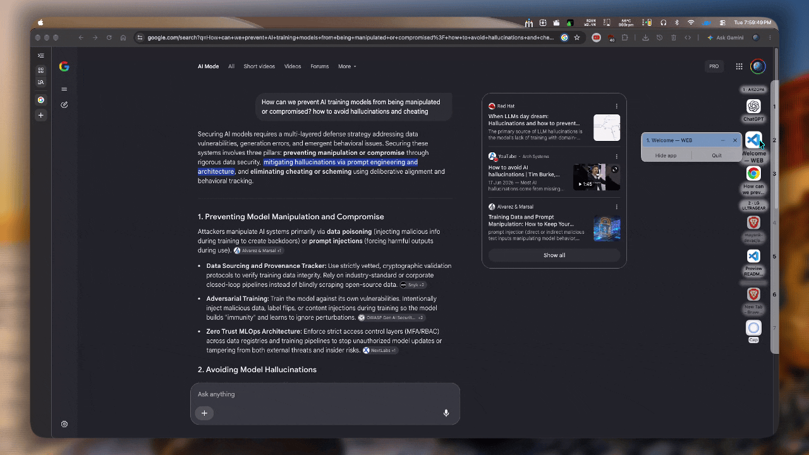
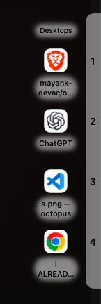
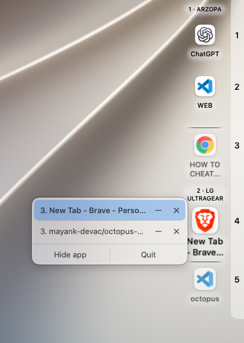
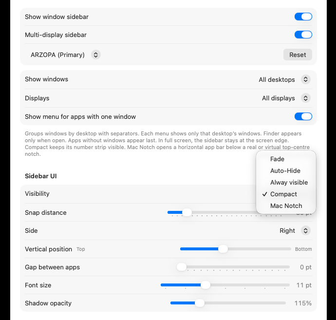
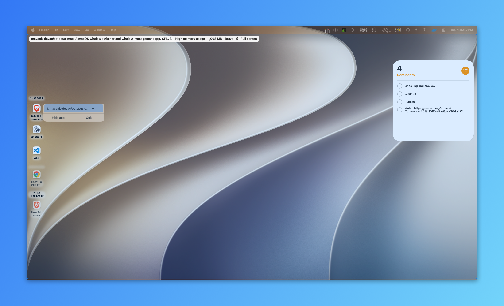
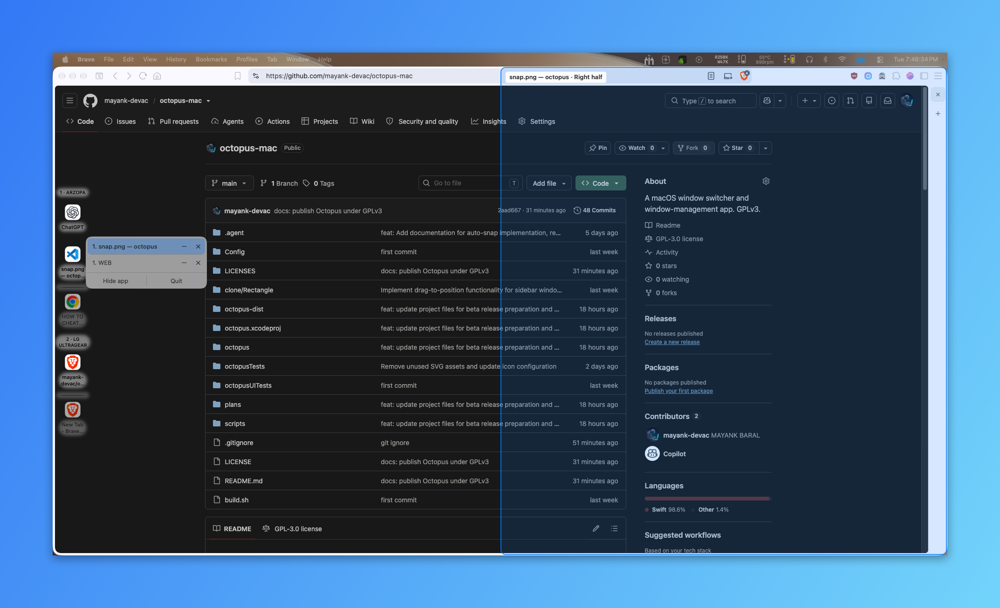
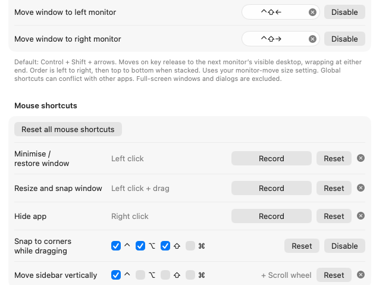
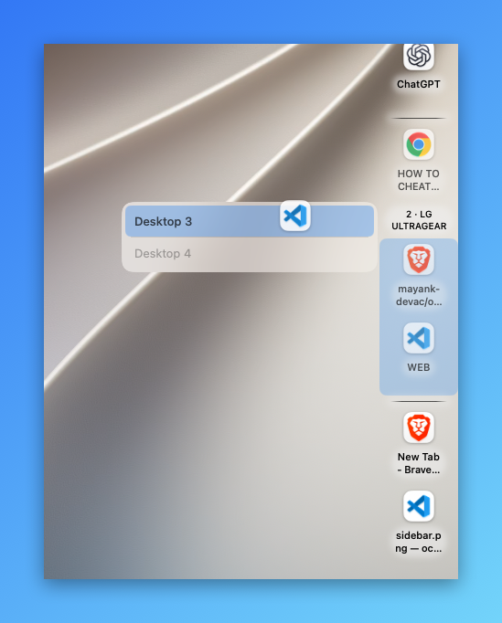
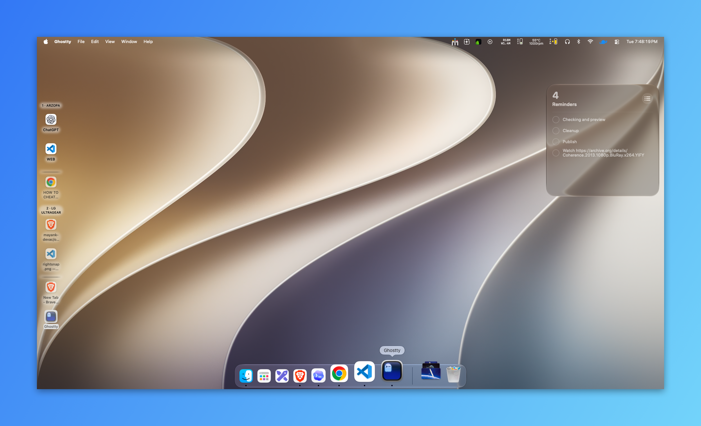

# octopus

<p align="center">
  <a href="octopus/assets/app.gif">
    
  </a>
</p>

> 🚧 **Beta:** Octopus may have bugs in window snapping and other edge cases.
> Users and developers are welcome to [report a bug](https://github.com/mayank-devac/octopus-mac/issues)
> or [contribute a fix or improvement](https://github.com/mayank-devac/octopus-mac/pulls).

## Why use Octopus?

- 🧭 **Sidebar:** keep apps and windows within easy reach.
- 🖱️ **Drag and drop:** move windows straight from the sidebar.
- 🧲 **Snap:** arrange windows in halves or quarters with the corner shortcut.
- 🤝 **Pair windows:** drop one app icon onto another for a side-by-side view.
- 🪟 **Window layouts:** automatically fit other windows beside your snapped window.
- ↩️ **Undo:** reverse the last layout adjustment.
- 💻 **Mac Notch mode:** keep the sidebar around your MacBook’s notch.
- 🖥️ **Multiple monitors:** use a sidebar on each display and move windows between them.
- ⌨️ **Keyboard shortcuts:** bind apps to number keys for quick switching.
- 🖱️ **Mouse shortcuts:** customise snapping, minimising, and hiding actions.
- 🗂️ **Profiles:** switch app bindings for work, study, or browsing.
- 🚀 **Per-app window switching:** cycle through one app’s windows with an Alt-Tab-style panel.
- 🌐 **Desktops:** move windows between macOS Desktops from the sidebar.
- 🎨 **Your setup:** customise sidebar position, spacing, labels, and idle behaviour.

Octopus is a macOS window switcher and window-management app. This repository is
Mayank Baral's modified version of the original Octopus by Xander Gouws and Omar Hayat.

download beta : [octopus-dist](https://github.com/mayank-devac/octopus-dist/releases).

## See Octopus in action

Click any screenshot for a closer look.

<table>
  <tr>
    <td width="50%" align="center" valign="top">
      <a href="octopus/assets/sidebar.png"></a>
      <p><strong>🧭 Window sidebar</strong><br>Keep your apps and windows within reach.</p>
    </td>
    <td width="50%" align="center" valign="top">
      <a href="octopus/assets/windows.png"></a>
      <p><strong>🪟 Find a window</strong><br>Pick a window, minimise it, or close it from the sidebar.</p>
    </td>
  </tr>
  <tr>
    <td width="50%" align="center" valign="top">
      <a href="octopus/assets/mac%20notch.png"></a>
      <p><strong>💻 Mac Notch mode</strong><br>Keep your app bar just below the notch.</p>
    </td>
    <td width="50%" align="center" valign="top">
      <a href="octopus/assets/preferences.png"></a>
      <p><strong>🎨 Make it yours</strong><br>Choose displays, sidebar position, spacing, and visibility.</p>
    </td>
  </tr>
  <tr>
    <td width="50%" align="center" valign="top">
      <a href="octopus/assets/snap.png"></a>
      <p><strong>🖱️ Drag to position</strong><br>Preview where your window will go before dropping it.</p>
    </td>
    <td width="50%" align="center" valign="top">
      <a href="octopus/assets/rightsnap.png"></a>
      <p><strong>🧲 Snap to a half (auto-snap)</strong><br>drag app icon from sidebar and Place a window on one side</p>
    </td>
  </tr>
  <tr>
    <td width="50%" align="center" valign="top">
      <a href="octopus/assets/darg%20to%20snap%20.png"></a>
      <p><strong>🤝 Window layouts</strong><br>Adjust other windows after snapping, or pair two app windows.</p>
    </td>
    <td width="50%" align="center" valign="top">
      <a href="octopus/assets/shortcuts.png"></a>
      <p><strong>⌨️ Your shortcuts</strong><br>Customise keyboard and mouse actions for windows and monitors.</p>
    </td>
  </tr>
  <tr>
    <td width="50%" align="center" valign="top">
      <a href="octopus/assets/desktops.png"></a>
      <p><strong>🌐 Move between Desktops</strong><br>Send a window to another macOS Desktop from the sidebar.</p>
    </td>
    <td width="50%" align="center" valign="top">
      <a href="octopus/assets/open.png"></a>
      <p><strong>🖥️ Multiple monitors</strong><br>See your running apps grouped by display.</p>
    </td>
  </tr>
</table>

## Key Features

octopus lets you bind applications to number keys and cycle through their windows with
an Alt-Tab-like interface. We built octopus because we wanted a fast and simple window
switcher for macOS — and it has grown into a keyboard-and-mouse window manager:

### App and window switching
- Bind applications to number keys to refocus to **any** window for that app
- Assign profiles for different sets of bindings
- Do your binding and profile management through the keyboard
- Optional numpad <kbd>0</kbd>–<kbd>9</kbd> for the same shortcuts (off by default, because
  those combinations can conflict with other apps)
- Independently configurable modifiers for binding, switching, and profile switching
- Per-app Alt-Tab panel with macOS notch awareness and refined anchoring
- Show the active profile in the menu bar, or hide the menu bar icon entirely

### Window sidebar
- A vertical app bar listing running apps and their windows on the selected display
- Click an app icon to show and focus it; click again to minimise or restore
  (configurable: do nothing, hide, or minimise/restore)
- Window menus for: focus window, minimise/restore, close window, move to another
  Desktop, and pair windows
- Apps without windows appear last with grey fills, and can be reopened from their icon
- Desktop scope (all Desktops or visible Desktops) and display scope (all displays or
  the current one)
- Multi-display sidebars with per-display settings, including one sidebar per monitor
- Idle behaviour: fade, auto-hide, always visible, compact, or Mac Notch
- Move the sidebar along its screen edge with <kbd>Control</kbd> + scroll wheel
- Adjustable: screen edge, vertical position, label font size, text shadow opacity,
  and gap between apps

### Window management
- Drag sidebar windows to snap them to halves, quarters, screen corners, or maximise
- Drag one app icon onto another to pair just those two windows on the chosen side
- Configurable snap distance from screen edges, and a configurable corner-snap shortcut
  (<kbd>Control</kbd> + <kbd>Option</kbd> + <kbd>Shift</kbd> by default)
- Automatically adjust other windows after a snap — the most recently used other
  window, or all other normal windows — with Undo for the last adjustment
- Group windows from different apps with a centre-hover drop, then switch using the
  attached top tab strip; inactive windows remain stacked behind the selected tab
- Move the focused window between monitors with <kbd>Control</kbd> + <kbd>Shift</kbd> +
  arrow keys (left/right, wrapping at either end, top-to-bottom when monitors are
  stacked), keeping original size or filling the screen
- Move individual windows to another Desktop from the sidebar
- Cross-desktop focus that navigates to a window's Desktop instead of briefly
  surfacing it on the current one
- Safety checks throughout: fixed-size, minimised, modal, sheet, and full-screen
  windows are detected and reported instead of being moved incorrectly

### Mouse shortcuts
- Record mouse buttons (with optional modifiers) for: resize and snap window,
  minimise/restore window, and hide app
- Defaults: left click = resize and snap, right click = minimise/restore
- <kbd>Control</kbd> + scroll wheel over the sidebar moves it vertically
- Reset any recorded shortcut from Preferences

### Updates
- Built-in Sparkle 2 updater with feed and EdDSA signature verification
- **Check for updates…** in the menu bar


## Usage

### Binding
You should start by binding different applications to the number keys. You can do this:
- through **Preferences → Profiles** (accessed through the menu bar), or
- by selecting the application of your choice and then pressing <kbd>Ctrl</kbd> + <kbd>Option</kbd> + <kbd>Shift</kbd>.

If you also use a numeric keypad for other apps, enable **Use numpad digits for
shortcuts** in **Preferences → Shortcuts**; it is off by default.

### Profiles
You can also set your bindings up in different profiles.

For example, you may want two profiles:
- "Coding": Which binds your favourite editor, browser, and terminal
- "Browsing": Which binds your favourite web browser, messaging app, and music client

You can switch between profiles:
- using the menu bar, or
- by binding them to the number keys, and then pressing <kbd>Ctrl</kbd> + <kbd>Option</kbd> + <kbd>[0-9]</kbd>.

Profiles can also appear in the menu bar so the active one is always visible.

### Switching applications
Suppose you're in your coding profile, and have your editor bound to `0`.

To switch between apps and windows:
1. Hold <kbd>Control</kbd> and press <kbd>0</kbd> to open a panel showing each of your editor's windows.
2. Press <kbd>0</kbd> multiple times to select the specific window you want.
3. Release <kbd>Control</kbd> to switch to the selected window.

In this way, octopus gives every app its own 'Alt-Tab'.

Note that window switching is scoped to your current [macOS space](https://support.apple.com/en-ca/guide/mac-help/mh14112/mac).

### The sidebar
The sidebar sits along a screen edge and lists your apps and their windows:

- Click an app icon to focus its most recent window; click it again to minimise or
  restore (change this under **Preferences → Sidebar**).
- Open an app's window list to focus, minimise/restore, close a window, or move it
  to another Desktop.
- Drag an app icon to move that app's window: release near a screen edge or corner
  to snap it, or drop it onto another app icon to pair the two windows.
- Use **Expand sidebar** for a wider view, and <kbd>Control</kbd> + scroll to slide the
  sidebar up or down its edge.
- Choose **Fade**, **Auto-Hide**, **Alway visible**, **Compact**, or **Mac Notch**
  in **Preferences → Sidebar**. Compact keeps a thin number strip at the edge and
  expands on hover; Mac Notch turns the sidebar into a top-centre bar that opens
  below the notch (a hardware notch is used automatically when present).

### Snapping and pairing windows
- Drag a sidebar window toward a screen edge to snap it to that half. While dragging,
  hold <kbd>Control</kbd> + <kbd>Option</kbd> + <kbd>Shift</kbd> to snap to a quarter or
  corner instead. Drag to the top edge, or use the maximise target, to fill the screen.
- Drop a window onto another visible app icon to pair exactly those two windows on the
  chosen side of the outlined icon. This works even when automatic adjustment is off.
- After a snap, Octopus can rearrange the other normal windows on that display and
  Desktop — either the most recently used window or all of them — and offers
  **Undo last adjustment**. Snap distance, snap areas, and companion selection are
  configurable in **Preferences → Window Layout**.
- If an app refuses a size or position (fixed-size windows, minimum sizes, or
  non-overlapping constraints), Octopus keeps the window reachable and tells you why.

### Tab groups
- Enable **Adjust windows when snapping** and choose **Most recently used window**.
- Drag a real window over the middle of another window on the same visible display
  and Desktop. Hover for the highlight, then release to group them. The window under
  the pointer is the target; ordinary edge snaps continue to work.
- You can also drag one sidebar app icon onto another: pause in its centre to group
  the two windows as tabs, or use its left/right/top/bottom edges for side-by-side snapping.
  An accepted side-drop layout separates the two selected windows from existing tab
  groups. Pair Undo restores window positions, not previous tab membership.
- Use the top strip to switch windows. Each tab shows the app icon and window name;
  windows from the same app remain separate tabs.
  Drop another window onto a member's centre to add it to the existing group.
- Drag the **≡ grip** or empty space on the strip to move the whole group within
  its current display. The strip previews the position; the real windows move
  after release. Escape cancels. Dragging an individual tab still moves it out.
- Press **Control+Tab** for the next grouped window or **Control+Shift+Tab** for
  the previous one. The order wraps at the ends. Ordinary app windows retain
  their own shortcuts; conflicting Octopus bindings take priority. Holding Tab
  switches once per press, and presses during an unfinished switch are ignored.
- Drag a tab out onto the same display, or right-click **Move out**, to separate it.
  Each tab's **X**, or right-click **Close window**, uses the app's normal close action
  and save prompts. Cancelling a save prompt keeps the window and its tab.
- Moving, resizing or snapping the active window aligns the other members after the gesture.
  The strip follows the real window's position and width during the gesture.
  An unrelated window can snap beside a group; only the active member participates
  in automatic companion selection, then the remaining tabs follow it.
  No background windows are resized while the mouse is held down.
  Known member size limits are used during snap planning. If an app refuses the
  final shared size, Octopus reports the failure and removes that group's strip;
  it leaves the real windows accessible and does not retry or force the resize.
  A stale read or cancelled arrangement keeps membership and waits for a new
  window change, rather than removing the strip or repeatedly trying the layout.
- Full-screen windows, fixed-size windows, and windows with open dialogs cannot join.
  Minimising or entering full screen separates that member. Moving a member to a
  different display or Desktop separates it when its new scope can be verified.
- Turning adjustment off, choosing **All windows**, changing display topology, or
  quitting Octopus removes the strips and leaves the real windows accessible.
  Groups are temporary and are not restored after relaunch.

### Moving windows between monitors and Desktops
- Hold <kbd>Control</kbd> + <kbd>Shift</kbd> and press an arrow key to move the focused
  window to the next monitor. It wraps at either end and uses your chosen move size
  (original size or full screen). Full-screen windows and dialogs are skipped.
- Drag a window to another monitor's visible Desktop to move it there, keeping its
  size or filling the screen depending on your setting. Moving to an inactive Desktop
  always keeps the current size.
- From a window's sidebar menu, use **Move to …** to send it to another Desktop.
- Selecting a window on another Desktop focuses it there without first surfacing it on
  your current Desktop.

### Mouse shortcuts
In **Preferences → Shortcuts**, click **Record** and then click with the mouse button
you want (modifiers optional, <kbd>Escape</kbd> cancels):

| Action | Default |
| --- | --- |
| Resize and snap window | Left click |
| Minimise / restore window | Right click |
| Hide app | Not set |

Click and drag shortcuts work on sidebar app icons; inactive apps focus first. Hide
and minimise must use different shortcuts.

### Customization

You can customize the modifiers for switching applications and profiles, and for binding different applications in **octopus Preferences → Shortcuts**.

octopus also pairs well with [Rectangle](https://github.com/rxhanson/Rectangle):
- Rectangle positions & re-arranges your windows
- octopus re-focuses your windows


## Installation

Simply: 
1) Download the `.zip` and unzip the file.
2) Drag `octopus.app` into your Applications folder.

Beta downloads, when available, are published in
[octopus-dist](https://github.com/mayank-devac/octopus-dist/releases).
This source repository does not provide a newly built or notarized app.

### Compatibility

octopus is compatible with **macOS 14.6 (Sonoma)** and onwards. 

You can find your macOS version from the **** → About This Mac** page.

The app moves and resizes other apps' windows, so it needs Accessibility permission
(**System Settings → Privacy & Security → Accessibility**). octopus prompts for it and
links straight to that pane. Without it, window management is unavailable and octopus
still works as an app switcher when macOS allows.


## Development

Clone this repository and open the Xcode project:

```sh
git clone https://github.com/mayank-devac/octopus-mac.git
cd octopus-mac
open octopus.xcodeproj
```

Use Xcode with a macOS SDK supported by the project. Xcode resolves the
KeyboardShortcuts and Sparkle packages automatically. Select the `octopus`
scheme and **My Mac** as the destination.

For a local app build, choose your own team under **Signing & Capabilities** for
the app and test targets. The existing team ID belongs to the maintainer; it
does not include signing credentials or give you access to that team.
Use a unique bundle identifier for your local build if required by signing.
Never commit signing certificates, private keys, passwords, or local credentials.

To build without signing from Terminal:

```sh
xcodebuild -project octopus.xcodeproj -scheme octopus \
  -configuration Debug -destination 'platform=macOS' \
  -derivedDataPath .build/DerivedData CODE_SIGNING_ALLOWED=NO build
```

The app target supports macOS 14.6 or later; the test targets require macOS 15
or later. Local builds need Accessibility permission to control other apps.
The updater currently points to the maintainer's `octopus-dist` feed and verifies
updates using its public signing key. Fork maintainers should configure their
own feed and public key before distributing builds.

Issues and pull requests are welcome. Include your macOS version, steps to
reproduce the issue, and the result you expected. Do not include private window
titles, account details, or credentials in reports.


## Licence

This version of Octopus is distributed under **GNU GPL version 3 only
(GPL-3.0-only)**; see [LICENSE](LICENSE). Modifications to Octopus are
Copyright (c) 2026 Mayank Baral.

The original Octopus code by Xander Gouws and Omar Hayat was released under MIT.
Its existing copyright and permission notices are preserved in
[LICENSES/Octopus-MIT.txt](LICENSES/Octopus-MIT.txt). Previously MIT-licensed
versions remain available under their original terms.

The Rectangle reference files retain their own [MIT licence](clone/Rectangle/LICENSE)
and are not compiled or bundled. External dependencies retain their respective
licences: [KeyboardShortcuts](https://github.com/sindresorhus/KeyboardShortcuts)
and [Sparkle](https://github.com/sparkle-project/Sparkle).

When distributing a build of this GPLv3 version, include the required licence
notices and provide its matching source code under GPLv3. The private release
scripts are not included; the source build command above uses standard Xcode tools.


## FAQ
<details>
<summary><b>Why is it called "octopus"?</b></summary>
<br>
The name comes from the starting sounds of the words "refocus" and "reframe". And, like a coral octopus supports a diverse ecosystem, octopus supports your workspace—helping you navigate between windows quickly and easily.
</details>

<details>
<summary><b>Why does octopus need Accessibility permission?</b></summary>
<br>
macOS only lets an app read and move another app's windows with Accessibility
access. octopus uses it to list windows, focus them, and place them. Window
switching that macOS itself permits keeps working without it.
</details>

<details>
<summary><b>Why can't octopus move a particular window?</b></summary>
<br>
Some windows refuse to move or resize: fixed-size dialogs, minimised or
full-screen windows, sheets, and windows on hidden Desktops. octopus checks
before acting, skips what it cannot move, and shows the reason instead of
failing silently.
</details>

<details>
<summary><b>Does octopus watch what I do?</b></summary>
<br>
No. octopus has no analytics, accounts, or network calls other than the update
check, and everything else stays on your Mac.
</details>


## Related Projects
- [yabai](https://github.com/asmvik/yabai)
- [Aerospace](https://github.com/nikitabobko/AeroSpace?tab=readme-ov-file)
- [Rectangle](https://github.com/rxhanson/Rectangle)
- [AltTab for macOS](https://github.com/lwouis/alt-tab-macos/tree/master)
